  
  &#8287;&#8287;&#8287;&#8287;&#8287;
  

Marseille, France &nbsp;·&nbsp; Stage dès le 29 mars 2027

---

## À propos

Étudiant en **BUT Informatique** (2e année) à l'IUT d'Aix-Marseille, site d'Arles, parcours *Réalisation d'applications*.
Je développe des applications de bout en bout : interface, API, base de données, tests.
La **cybersécurité** est ce qui me motive le plus. Je code au quotidien avec l'IA et je fais des essais d'**IA locale** (des modèles qui tournent sur ma propre machine).

Je cherche un **stage de 2e année à partir du 29/03/2027** (convention de 3 mois, prolongation possible en CDD) en développement full-stack, cybersécurité, données ou IA.

---

## Stack

Et aussi : Scrum · UML · VirtualBox · Excel (avancé) · Sage 100

---

## Projets

<table>
<tr>
<td width="50%" valign="top">

### [log-anonymizer](https://github.com/NeneGoto/log-anonymizer)
**Masquer les données sensibles dans les logs**
Python · pytest

Outil en ligne de commande qui masque les IP, e-mails, tokens et mots de passe dans des logs texte ou JSON, avec des règles regex configurables. Couvert par **43 tests automatisés**.

</td>
<td width="50%" valign="top">

### Application web 3D
**Hackathon Dev'Art 2026 · Prix du Jury**
Next.js · Three.js · TypeScript

Application web 3D interactive réalisée en équipe pendant le hackathon.

</td>
</tr>
<tr>
<td width="50%" valign="top">

### ArchiSim
**Simulateur 64 bits (RAM / CPU)**
FastAPI · Vue.js

Moteur d'émulation exposé par une API temps réel, avec une interface web. J'étais **Product Owner** : besoins, priorités, démos, Scrum.

</td>
<td width="50%" valign="top">

### Base de données relationnelle
**Modélisation et SQL avancé**
PostgreSQL · WinDesign

Modèles MCD / MLD, requêtes SQL avancées et triggers PostgreSQL.

</td>
</tr>
</table>

Aussi : un gestionnaire d'immatriculations en **C++17 / Qt 6** (binôme, UML, XML / JSON), et un poste de dev et réseau multiboot **Debian 12 / Windows 11** avec un serveur mail Postfix.
Tous les détails sont sur mon **[portfolio](https://portfolio-1-gamma-azure.vercel.app)**.

---

## Activité GitHub

---

## Côté cyber

- Je protège les données dès le code : c'est l'idée de **log-anonymizer** (ne rien laisser fuiter dans les logs).
- Je m'entraîne au hacking éthique **uniquement sur mon lab local**, sous Linux.
- Je m'intéresse à la sécurité des applications web et des API, et à l'administration Linux et réseau.

---

## Mode stratégie

Terminal et échiquier dessinés à la main en SVG animé · logos officiels des technologies.
